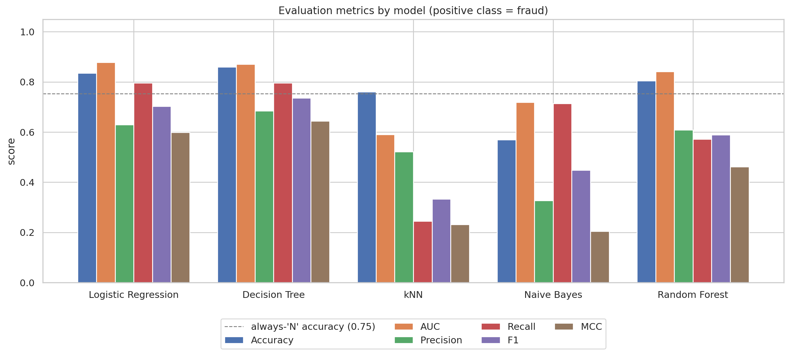
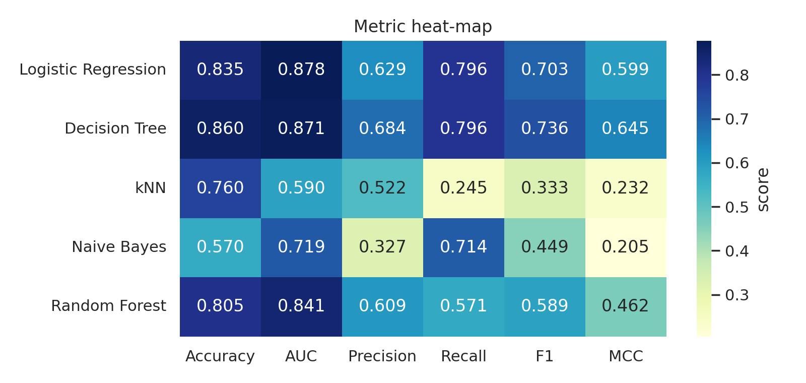
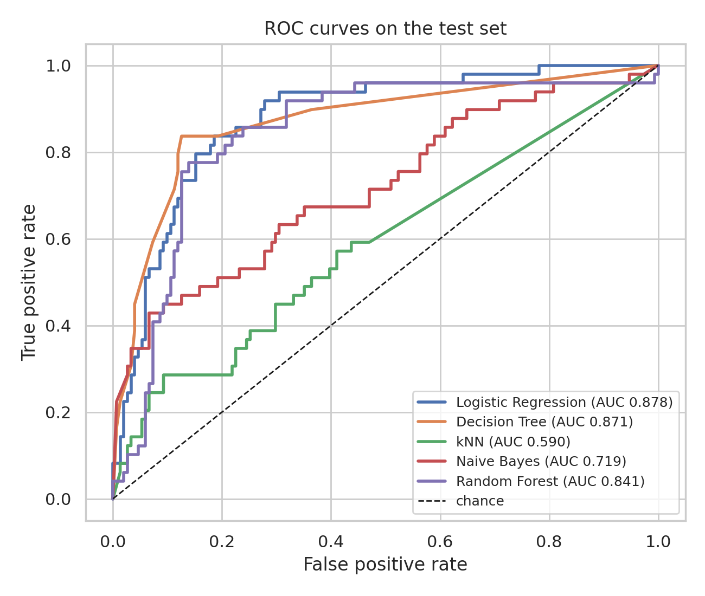
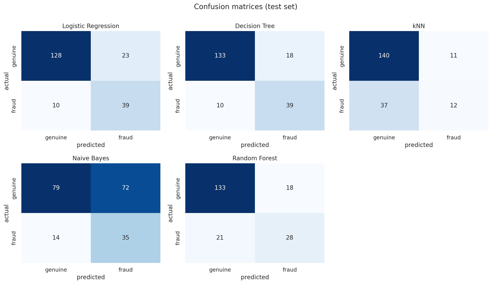

# ML Assignment 2 – Insurance Claim Fraud Detection

| | |
|---|---|
| **BITS ID** | 2026CT05073 |
| **Programme** | M.Tech (AIML) – Work Integrated Learning Programmes Division |
| **Course** | Machine Learning |
| **Task** | Binary classification – detect fraudulent auto-insurance claims |

---

## 1. Problem Statement

Insurance companies lose a large amount of money to fraudulent claims, but only a small share of claims is actually fraudulent, so investigators cannot examine every claim by hand. The goal of this project is to build a **binary classifier that flags a claim as fraudulent (`Y`) or genuine (`N`)** using policy details, customer details and incident details, so that a limited investigation budget can be directed at the riskiest claims.

Six classification models are trained on the **same** data and the **same** stratified 80:20 train–test split, and compared on six evaluation metrics:

1. Logistic Regression
2. Decision Tree
3. K-Nearest Neighbours (kNN)
4. Naive Bayes (Gaussian)
5. Random Forest (ensemble)
6. XGBoost (ensemble)

Metrics: **Accuracy, AUC, Precision, Recall, F1 and Matthews Correlation Coefficient (MCC)**.

Because fraud is the minority class and a missed fraud costs more than a false alarm, Accuracy alone is misleading here. Recall, F1, AUC and MCC are given particular weight when comparing models.

---

## 2. Dataset Description

| Item | Detail |
|---|---|
| **Dataset** | *Insurance Claims* (auto-insurance fraud), file `insurance_claims.csv` |
| **Source** | Kaggle / Mendeley Data (DOI 10.17632/992mh7dk9y); public copy used: `github.com/mwitiderrick/insurancedata` |
| **Size** | 1,000 claims × 39 columns (34 predictors after dropping identifiers and dates, and adding 2 engineered features) |
| **Task** | Binary classification – is the claim fraudulent? |
| **Target** | `fraud_reported` (`Y` = fraud → 1, `N` = genuine → 0) |
| **Class balance** | 24.7 % fraud / 75.3 % genuine (imbalanced) |
| **Train / test** | 800 / 200 rows, stratified, `random_state = 5073` (test set has 49 frauds) |

**Why this dataset:** it is a realistic *imbalanced* problem where the choice of metric matters; it mixes numeric, categorical and date columns; it contains real missing values (marked `?`); and it comfortably meets the assignment’s minimum size requirements (1,000 rows, 34 predictors).

**Feature groups**

| Group | Examples |
|---|---|
| Customer / policy (numeric) | `months_as_customer`, `age`, `policy_deductable`, `policy_annual_premium`, `umbrella_limit`, `capital-gains`, `capital-loss` |
| Customer / policy (categorical) | `policy_state`, `policy_csl`, `insured_sex`, `insured_education_level`, `insured_occupation`, `insured_hobbies`, `insured_relationship` |
| Incident | `incident_type`, `collision_type`, `incident_severity`, `authorities_contacted`, `incident_state`, `incident_city`, `property_damage`, `police_report_available`, `incident_hour_of_the_day`, `number_of_vehicles_involved`, `bodily_injuries`, `witnesses` |
| Claim amounts | `total_claim_amount`, `injury_claim`, `property_claim`, `vehicle_claim` |
| Vehicle | `auto_make`, `auto_model` |
| Engineered | `policy_age_days` (incident date − policy bind date), `vehicle_age` (incident year − `auto_year`) |

**Preprocessing (identical for all models, fitted on training data only – no leakage):**

- `?` values converted to missing; categorical gaps filled with an explicit `"Unknown"` category, numeric gaps with the training median.
- Identifier-like columns (`policy_number`, `insured_zip`, `incident_location`) and raw dates dropped.
- Numeric features standardised; categorical features one-hot encoded (`handle_unknown="ignore"`).
- No duplicate rows were found.

---

## 3. GitHub Repository Link

**https://github.com/2026ct05073/2026CT05073-ML-Assignment-2**

Repository contents:

```
2026CT05073-ML-Assignment-2/
├── README.md                      # this file
├── 2026CT05073_ML_Assignment_2.ipynb
├── requirements.txt
├── insurance_claims.csv           # dataset
├── test_data.csv                  # held-out 20 % test split
├── model/                         # saved models (.joblib), one per classifier
└── outputs/                       # comparison table (CSV), charts, run summary
```

---

## 4. Models Used

### 4.1 Comparison table (test set, positive class = fraud)

| ML Model Name | Accuracy | AUC | Precision | Recall | F1 | MCC |
|---|---|---|---|---|---|---|
| Logistic Regression | 0.8350 | **0.8776** | 0.6290 | **0.7959** | 0.7027 | 0.5985 |
| Decision Tree | **0.8600** | 0.8709 | **0.6842** | **0.7959** | **0.7358** | **0.6447** |
| kNN | 0.7600 | 0.5905 | 0.5217 | 0.2449 | 0.3333 | 0.2319 |
| Naive Bayes | 0.5700 | 0.7193 | 0.3271 | 0.7143 | 0.4487 | 0.2048 |
| Random Forest (Ensemble) | 0.8050 | 0.8413 | 0.6087 | 0.5714 | 0.5895 | 0.4622 |
| XGBoost (Ensemble) | 0.8550 | 0.8351 | 0.6724 | **0.7959** | 0.7290 | 0.6351 |

Best value per column in **bold**. Majority-class baseline (always predict "genuine") accuracy = **0.7530**.

### 4.2 What each model actually predicted (test set, 200 claims, 49 frauds)

| Model | Frauds caught (TP) | Frauds missed (FN) | False alarms (FP) | Genuine cleared (TN) |
|---|---|---|---|---|
| Logistic Regression | 39 | 10 | 23 | 128 |
| Decision Tree | 39 | 10 | 18 | 133 |
| kNN | 12 | 37 | 11 | 140 |
| Naive Bayes | 35 | 14 | 72 | 79 |
| Random Forest | 28 | 21 | 18 | 133 |
| XGBoost | 39 | 10 | 19 | 132 |

### 4.3 Hyper-parameters used

| Model | Settings |
|---|---|
| Logistic Regression | `class_weight="balanced"`, `max_iter=2000` |
| Decision Tree | `max_depth=5`, `min_samples_leaf=10`, `class_weight="balanced"` |
| kNN | `k = 3` (chosen by 5-fold stratified CV on the training set, F1 scoring), distance-weighted |
| Naive Bayes | Gaussian NB, defaults |
| Random Forest | 300 trees, `min_samples_leaf=3`, `class_weight="balanced_subsample"` |
| XGBoost | 300 trees, `max_depth=3`, `learning_rate=0.05`, `subsample=0.8`, `colsample_bytree=0.8`, `scale_pos_weight ≈ 3.04` (negatives ÷ positives in training data) |

### 4.4 Graph representation of all metrics 

**All six metrics for all six models**



**Same numbers as a heat-map**



**ROC curves**



**Confusion matrices**



### 4.5 Observations on model performance  [3 marks]

The test set has 200 claims, of which 49 are fraud, so every fraud caught or missed moves Recall by about 2 percentage points. Small differences between models should therefore not be over-interpreted.

| ML Model Name | Observation about model performance |
|---|---|
| **Logistic Regression** | Strong and well balanced. Highest **AUC (0.878)**, meaning it ranks risky claims better than any other model, and it caught 39 of 49 frauds (Recall 0.796). The cost is 23 false alarms, so Precision (0.629) and F1 (0.703) are a little below the Decision Tree. Standardised inputs plus `class_weight="balanced"` let a linear model work well here; its largest coefficients are `insured_hobbies = chess`, `insured_hobbies = cross-fit` and `incident_severity = Major Damage`, which suggests most of the fraud signal sits in a few categorical indicators. |
| **Decision Tree** | **Best overall.** Highest Accuracy (0.860), Precision (0.684), F1 (0.736) and MCC (0.645), and ties for the best Recall (0.796). It caught the same 39 frauds as Logistic Regression with fewer false alarms (18 vs 23). Roughly half of its importance comes from `incident_severity = Major Damage` and about 41 % from the two hobby indicators, so a shallow tree (depth 5, 10 samples per leaf) captures the main rules without memorising the 800 training rows. Caveat: a single tree is high-variance, so its lead over Logistic Regression and XGBoost is small and could change with a different split. |
| **kNN** | **Weakest at finding fraud.** Accuracy of 0.760 is only 0.7 points above the always-"genuine" baseline (0.753), and it caught just 12 of 49 frauds (Recall 0.245, MCC 0.232). After one-hot encoding there are about 160 features, most of them irrelevant, so distances are dominated by noise and neighbours are rarely informative. Cross-validated F1 also fell steadily as `k` grew (0.245 at k = 3 down to 0.057 at k = 21), consistent with the minority class being swamped by majority-class neighbours. Its low AUC (0.591) confirms the problem is ranking, not just the threshold. |
| **Naive Bayes** | **Only model below the baseline on Accuracy (0.570).** It flags aggressively: Recall is fairly high (0.714) but it raises 72 false alarms, so Precision collapses to 0.327. The Gaussian and independence assumptions fit one-hot columns and correlated claim amounts poorly (`total_claim_amount` is the sum of the other three), so its probabilities are badly calibrated at the 0.5 threshold. Its AUC (0.719) is much better than its F1, which suggests the ranking is not useless and a higher decision threshold could help. |
| **Random Forest (Ensemble)** | Better than kNN and Naive Bayes but, unexpectedly, behind the simpler Decision Tree and Logistic Regression. It caught only 28 of 49 frauds (Recall 0.571, F1 0.590, MCC 0.462) with 18 false alarms. A likely reason is that the strongest signals are concentrated in a few columns while the forest spreads importance over many weak features (claim amounts, every severity level); with only 800 training rows and ~160 encoded features, averaging 300 randomised trees dilutes those few strong features. Tuning (e.g. smaller `max_features`, lower decision threshold) might change this and was not done. |
| **XGBoost (Ensemble)** | Best-performing ensemble and effectively tied with the Decision Tree. It caught the same 39 frauds (Recall 0.796) with 19 false alarms (Precision 0.672), giving Accuracy 0.855, F1 0.729 and MCC 0.635, within about one percentage point of the Decision Tree on every metric. Class imbalance was handled with `scale_pos_weight`, and shallow trees (`max_depth=3`) with a low learning rate suit the small dataset, which is a likely reason it beats Random Forest here. Its AUC (0.835) is slightly *below* Logistic Regression (0.878) and the Decision Tree (0.871), so it is not the best at ranking claims. Hyper-parameters were set by hand, not tuned, so a tuned XGBoost could move either way. |

**Overall winner – Decision Tree** (ranked by MCC, then F1, then AUC). Accuracy alone would be misleading: kNN looks "acceptable" at 0.76 yet misses three of every four frauds. The practical trade-off for an insurer is between missed frauds (false negatives) and wasted investigations (false positives). Logistic Regression, the Decision Tree and XGBoost all catch 39 of 49 frauds and differ mainly in false alarms (23, 18 and 19), whereas Naive Bayes buys its recall with many false alarms and kNN and Random Forest miss too many frauds.

---

## 5. How to Reproduce

```bash
pip install -r requirements.txt
jupyter notebook 2026CT05073_ML_Assignment_2.ipynb   # run all cells
```

All randomness uses `SEED = 5073` (derived from the student ID), so results are reproducible. Saved models can be reloaded and applied to the exported test data:

```python
import joblib, pandas as pd
model = joblib.load("model/decision_tree.joblib")
data  = pd.read_csv("test_data.csv")
preds = model.predict(data.drop(columns="fraud_reported"))
```
